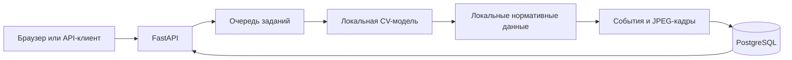

# Forte Cashier Guard

**Видеопроверка кассовой дисциплины с таймкодами, нормативными ссылками и кадрами для проверки человеком.**

Проект для дататона ForteBank. Пользователь загружает запись кассовой зоны, а сервис
предоставляет результат анализа в русском веб-интерфейсе и через асинхронный HTTP API.
Цель — помочь проверяющему найти эпизод и сопоставить наблюдаемые действия с локальной
базой правил. Результат требует проверки человеком и не является юридическим заключением.

[Инструкция для жюри](docs/JURY_INSTRUCTIONS.md) · [Интеграция модели](docs/MODEL_INTEGRATION.md) · [Эксплуатация](docs/OPERATIONS.md)

## Статус проекта

**Бэкенд и интерфейс готовы; Альфия подключает модель и нормативные данные.**
В опубликованной версии ещё нет рабочего `model_service.py` и весов модели.
Без них сервис возвращает технический ответ `no_violation`, который **не подтверждает
отсутствие нарушений**. Проверяйте `/health`: для реального анализа нужны
`model_loaded: true` и `demo_mode: false`.

| Компонент | Состояние |
| --- | --- |
| FastAPI, очередь заданий, авторизация API | Реализованы |
| Русский React-интерфейс, видеоплеер, галерея кадров | Интегрированы |
| PostgreSQL для статусов, результатов и JPEG-доказательств | Подключён |
| Docker Compose, запуск и диагностика в Windows | Подготовлены |
| Модель, её веса и локальные нормативные данные | Интеграция в процессе |
| Точность и скорость итоговой модели на компьютере сервиса | Требуют финальной проверки |

На этапе проверки инфраструктуры пройдено **119 тестов**, включая реальные HTTP-запросы
и сохранность результатов после перезапуска. Это проверка приложения, а не показатель
качества модели. Подробности: [отчёт о проверке](docs/HARDENING_VERIFICATION.md).

## Как работает сервис

1. Пользователь загружает видео `.mov` через браузер или API.
2. Сервер создаёт задание и сразу возвращает `job_id`.
3. Локальный модуль анализа определяет события и их таймкоды; при наличии источника
   к событию добавляется нормативное правило.
4. Сервер извлекает до трёх JPEG-кадров вокруг каждого события и сохраняет результат.
5. Интерфейс показывает вердикт, описание, правило, таймкод и увеличиваемые кадры.



Анализ рассчитан на локальное выполнение на CPU: без облачных AI API, анализа звука
и идентификации лиц. После предварительной сборки и размещения весов обработка
не должна требовать доступа в интернет. Публичному ngrok-туннелю интернет необходим.

## Подход к модели

Ниже описан подход из исследовательского ноутбука команды. Состав и параметры
итогового модуля нужно подтвердить после интеграции; это не перечень уже
развёрнутых компонентов.

| Этап | Подход |
| --- | --- |
| Подготовка видео | Выборка кадров с частотой 3 кадра/с, нормализация имён, устранение дубликатов |
| Разметка | CVAT: объекты, роли людей, состояния предметов и действия во времени |
| Предразметка | Сравнение OWLv2, Florence-2 и Grounding DINO; ручная коррекция небольших объектов |
| Детекция | Дообучение RT-DETRv2-R18 и экспорт в ONNX для CPU-инференса |
| Отслеживание | ByteTrack и области сцены, полученные из детекций конкретного видео |
| Роли, состояния и действия | DINOv2-small с отдельными классификаторами, описанными в плане дальнейших скриптов |
| Обоснование | Сопоставление событий с локальными нормативными источниками |

Схема разметки охватывает людей, сейф, дверь, ноутбук, наличные, упаковки, печать,
документы, чашки/еду, личные вещи, счётную машину и детектор банкнот. Наличие класса
в схеме не означает, что его качество уже подтверждено.

Для оценки предусмотрено разделение по целым видео: парные записи с нарушением
и исправленным сценарием остаются в одном fold. Дополнительно предусмотрены видео
с другого ракурса. Измеряются полнота обнаружения, ложные срабатывания, точность типа,
ошибка таймкода и попадание кадров в интервал около события.
Сохранённых результатов измерений в переданном ноутбуке нет, поэтому численные
показатели точности и производительности здесь пока не заявлены.

## Быстрый локальный запуск

Нужны Git и Docker с Docker Compose. Для Windows — Docker Desktop с Linux engine.
Node.js нужен только при изменении фронтенда; готовая сборка уже находится в `static/`.
Веса и нормативные данные передаются отдельно от исходников.

```powershell
git clone https://github.com/shahger/dataprompt.git
cd dataprompt
```

**Только для нового клона:** создайте `.env` из шаблона и задайте собственный длинный
случайный `API_KEY`. Для точной схемы ответа жюри добавьте `INCLUDE_RULE=false`.
Не заменяйте существующий рабочий `.env` и не публикуйте его.

```powershell
# Выполняйте только если .env ещё не существует.
if (-not (Test-Path .env)) { Copy-Item .env.example .env }
# Откройте .env в редакторе и настройте API_KEY и INCLUDE_RULE.
docker compose up -d --build
curl.exe http://localhost:8000/health
```

Откройте [локальный интерфейс](http://localhost:8000/).
Первый запуск требует сети для загрузки Docker-образов и зависимостей.
Без модели можно проверить загрузку и обработку заданий, но не качество детекции.

## Подключение модели

1. Экспортируйте инференс в корневой `model_service.py`, используя
   `model_service.py.template`. Не переносите обучение и установку пакетов в обработку запросов.
2. Разместите веса в `models/`, нормативные данные — в `data/` либо отдельной таблице
   локального PostgreSQL. Добавьте проверенные CPU-зависимости в `requirements-model.txt`.
3. Возвращайте список событий следующего вида; пустой список означает отсутствие найденных событий:

```python
def analyze_video(path, deadline=None):
    # Здесь вызывается реальная модель. Ниже — только пример структуры события.
    return [{
        "type": "Тип события",
        "timecode_sec": 12.3,
        "description": "Наблюдаемые признаки",
        "rule": "Проверенный источник, пункт и текст правила"
    }]
```

4. Проверьте контракт, пересоберите API и убедитесь в правильном ответе `/health`:

```powershell
python tools/check_model.py --video C:\data\video.mov
docker compose up -d --build --force-recreate api
curl.exe http://localhost:8000/health
```

Полный контракт, deadline, поиск правил и оценка скорости описаны в
[MODEL_INTEGRATION.md](docs/MODEL_INTEGRATION.md).
Демонстрационный режим предназначен только для проверки интерфейса и должен быть выключен
при оценке модели и проверке жюри.

## API для жюри

| Метод и путь | Назначение |
| --- | --- |
| `POST /api/v1/analyze` | Загрузка видео в multipart-поле `file`, ответ `{"job_id":"..."}` |
| `GET /api/v1/jobs/{job_id}` | Получение статуса и результата |
| `GET /health` | Состояние сервиса, модели и demo-режима |

Первые два маршрута требуют заголовок `X-API-Key`. При отсутствии или неверном ключе
возвращается HTTP 401. Состояния задания: `processing`, `done`, `failed`.
Пример завершённого ответа без найденных событий:

```json
{
  "job_id": "...",
  "status": "done",
  "verdict": "no_violation",
  "violations": []
}
```

При `verdict: "violation"` каждый элемент `violations` содержит `type`, `timecode_sec`,
`description` и `evidence_frames` с полями `timestamp_sec` и `image_base64`.
Если `INCLUDE_RULE=false` и `RULE_IN_DESCRIPTION=true`, доступное правило добавляется
в `description`. Браузер получает правило отдельно через `/ui/api/*` без встраивания ключа.

Примеры запросов и полная схема: [инструкция для жюри](docs/JURY_INSTRUCTIONS.md).

**Адреса командного стенда** — доступны, пока компьютер сервиса и туннель работают:

- Интерфейс: <https://reverence-culpable-cupping.ngrok-free.dev/>
- API base URL: `https://reverence-culpable-cupping.ngrok-free.dev/api/v1`
- Ключ передаётся жюри отдельно; в репозитории его нет.

При переносе сервиса на другой компьютер согласуйте окончательные адреса до подачи формы.
API-клиент может передать `ngrok-skip-browser-warning: 1`, если получает страницу ngrok
вместо JSON.

## Ограничения и хранение данных

- Формат подачи — `.mov`; технический предел одного файла — **200 МиБ**.
- Лимит жюри — **5 минут на видео**. Тайм-аут сервиса по умолчанию — **270 секунд**, включая очередь.
- На событие возвращается **1–3 JPEG-кадра**. На коротких видео и у границ число кадров может быть меньше.
- Загруженные видео удаляются после обработки; PostgreSQL сохраняет задания, результаты и кадры.
- Данные PostgreSQL находятся в Docker volume `pgdata`. Не используйте `docker compose down -v`, если они нужны.
- Число workers выбирается по измерениям на итоговом компьютере. Python-поток нельзя принудительно
  завершить: модель должна соблюдать deadline; зависший поток может удерживать worker до перезапуска.

## Разработка и проверка

```powershell
python -m venv .venv
.venv\Scripts\python -m pip install -r requirements-dev.txt
.venv\Scripts\python -m pytest -q
```

Тесты проверяют API-контракт, авторизацию, задачи, кадры, очистку файлов, UI и модельные
точки подключения. Live integration включается отдельно и рассчитана на сервис с заглушкой;
это не тест точности подключённой модели.

Для итоговой модели нужны отдельные измерения на размеченных видео и реальные HTTP-загрузки:

```powershell
python tools/bench_model.py --videos C:\data\videos --count 5 --workers 1 --sweep
.\scripts\check-public.ps1 -Video C:\data\video.mov
```

Benchmark измеряет инференс и очередь в процессе, без HTTP-передачи, БД и извлечения кадров.
Финальную скорость проверяйте также через публичный API. Инструменты `eval_labels.py` и
`load_test.py` описаны в [руководстве по интеграции](docs/MODEL_INTEGRATION.md).

Для изменений интерфейса: `scripts/build-frontend.ps1` собирает React/TypeScript/Vite
из `frontend/forte-cashier-guard-main/` в `static/`. После этого пересоберите API-образ.

## Структура репозитория

```text
main.py                    FastAPI, очередь и извлечение кадров
db.py                      Работа с PostgreSQL
model_service.py.template  Контракт локального инференса
rules_service.py.template  Контракт поиска нормативного правила
frontend/                  Исходники русского React-интерфейса
static/                    Готовая сборка и локальные ресурсы
models/                    Веса модели, передаются отдельно
data/                      Локальные нормативные данные, передаются отдельно
tools/                     Проверка модели, оценка и нагрузочные тесты
tests/                     Регрессионные тесты приложения
scripts/                   Сборка, запуск, диагностика и подготовка к сдаче
docs/                      Инструкции и отчёты
```

## Перед проверкой жюри

1. Подключите реальную модель и нормативные источники; проверьте качество и отсутствие demo-режима.
2. На выбранном компьютере проверьте длинное видео, другой ракурс и пять одновременных загрузок.
3. Проверьте публичные UI/API, ключ, схему ответа, таймкоды, правила и читаемость кадров.
4. Финализируйте инструкцию, сохраните изменения в Git и выполните строгую проверку:

```powershell
.\scripts\prepare-handover.ps1 -Finalize
# Просмотрите и закоммитьте изменение docs/JURY_INSTRUCTIONS.md.
.\scripts\prepare-handover.ps1
```

После `-Finalize` проверка может завершиться с FAIL до коммита изменённой инструкции.
Успешный `/health` и технический preflight не заменяют проверку точности модели.
Передайте жюри адреса, ключ отдельно, Git-ссылку и презентацию.
Оставьте компьютер включённым, на питании, без сна и с доступом к сети на всё время проверки.

Запуск ngrok, восстановление после выключения, настройки, диагностика и чистый архив:
[руководство по эксплуатации](docs/OPERATIONS.md).
Для командной работы создавайте отдельные ветки и pull request; не коммитьте `.env`,
ключи, исходные видео и приватные данные. Веса и данные передавайте отдельно с инструкцией размещения.
