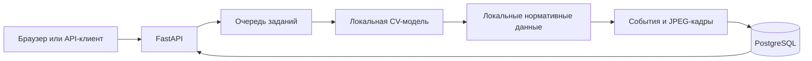

# Forte Cashier Guard

**Видеопроверка кассовой дисциплины с таймкодами, нормативными ссылками и кадрами для проверки человеком.**

Проект для дататона ForteBank. Пользователь загружает запись кассовой зоны, а сервис
предоставляет результат анализа в русском веб-интерфейсе и через асинхронный HTTP API.
Цель — помочь проверяющему найти эпизод и сопоставить наблюдаемые действия с локальной
базой правил. Результат требует проверки человеком и не является юридическим заключением.

[Инструкция для жюри](docs/JURY_INSTRUCTIONS.md) · [Интеграция модели](docs/MODEL_INTEGRATION.md) · [Эксплуатация](docs/OPERATIONS.md)

## Статус проекта

**Бэкенд, интерфейс и модель подключены.** `model_service.py` и пакет `ml/` находятся
в репозитории; **веса модели (~160 МБ) в Git не входят** и передаются отдельно
(распаковать в `models/`, см. «Подключение модели»). Без весов API не стартует с моделью.
Проверяйте `/health`: для реального анализа нужны `model_loaded: true` и `demo_mode: false`.

| Компонент | Состояние |
| --- | --- |
| FastAPI, очередь заданий, авторизация API | Реализованы |
| Русский React-интерфейс, видеоплеер, галерея кадров | Интегрированы |
| PostgreSQL для статусов, результатов и JPEG-доказательств | Подключён |
| Docker Compose, запуск и диагностика в Windows | Подготовлены |
| Модель (`model_service.py`, `ml/`) и база норм `rules/rules_db.json` | Подключены |
| Веса модели | Передаются отдельно, в `models/` |
| Скорость итоговой модели на компьютере сервиса | Требует финальной проверки |

На этапе проверки инфраструктуры пройдено **119 тестов**, включая реальные HTTP-запросы
и сохранность результатов после перезапуска. Это проверка приложения, а не показатель
качества модели. Подробности: [отчёт о проверке](docs/HARDENING_VERIFICATION.md).

## Как работает сервис

1. Пользователь загружает видео `.mov` через браузер или API.
2. Сервер создаёт задание и сразу возвращает `job_id`.
3. Локальный модуль анализа определяет события и их таймкоды; при наличии источника
   к событию добавляется нормативное правило.
4. Сервер извлекает до трёх JPEG-кадров вокруг каждого события и сохраняет результат.
5. Интерфейс показывает вердикт, описание, правило, таймкод и увеличиваемые кадры.



Анализ рассчитан на локальное выполнение на CPU: без облачных AI API, анализа звука
и идентификации лиц. После предварительной сборки и размещения весов обработка
не должна требовать доступа в интернет. Публичному ngrok-туннелю интернет необходим.

## Модель и обучение

Система сочетает детекцию объектов, признаки действий во времени и явные правила.
Модель не генерирует нормативные цитаты: текст берётся из локальной базы.
Описание модели — [MODEL.md](docs/MODEL.md), лицензии — [MODELS_LICENSES.md](docs/MODELS_LICENSES.md).

| Компонент | Обучение и назначение |
| --- | --- |
| RT-DETRv2-R18 | Детектор, предобученный на COCO; дообучен на разметке команды с AdamW, OneCycle и аугментациями, 6 эпох для v2. Экспортирован в ONNX |
| DINOv2-small | Замороженный экстрактор визуальных признаков; его веса при обучении классификаторов не меняются |
| Логистические классификаторы | Обучены с балансировкой классов на признаках объектов, геометрии и движения; определяют роли, состояния и действия |
| Калибровка правил | Подбирает пороги типов, поправки таймкодов и порог вердикта по видео с приоритетом полноты обнаружения |

Подготовка данных включает нормализацию имён видео, устранение дубликатов и разметку
в CVAT. Для предразметки сравнивались OWLv2, Florence-2 и Grounding DINO;
небольшие объекты требуют ручной коррекции. Схема разметки охватывает людей, сейф,
дверь, ноутбук, наличные, упаковки, печать, документы, чашки/еду, личные вещи,
счётную машину и детектор банкнот.

### Обработка каждого видео

```text
.mov → кадры 3 fps → RT-DETRv2 + ByteTrack → DINOv2 + геометрия + движение
     → классификаторы → таймлайн и учёт денег → правила и пороги
     → тип события, таймкод, описание и цитата НБРК → API / интерфейс
```

1. **Кадры.** OpenCV выбирает 3 кадра/с с учётом метаданных поворота.
2. **Объекты и треки.** ONNX Runtime запускает детектор на входе 640×640 на каждом
   втором выбранном кадре, а при более чем 150 выбранных кадрах — на каждом третьем.
   Между запусками используется последний результат. ByteTrack связывает людей
   в треки; для статических объектов сохраняется лучший бокс каждого класса.
   Перекрывающиеся боксы удаляются NMS с IoU 0.6. Пороги зависят от класса:
   например, 0.45 для человека, 0.35 для наличных, 0.05 для сейфа, двери и ноутбука.
3. **Визуальные и временные признаки.** DINOv2 объединяет CLS-токен и среднее
   patch-токенов в вектор из 768 значений. Для состояния предмета берётся кроп
   с отступом 15%; для роли человека к визуальному вектору добавляется геометрия
   его положения. Для действий используется более широкий кроп с отступом 45%,
   чтобы захватить руки и предметы рядом.
4. **Действия в контексте.** К признакам добавляются расстояния и перекрытия
   относительно сейфа, оборудования, двери и других людей. Окно ±2 с учитывает
   среднее состояние, изменение визуальных признаков и приближение к объектам.
   В текущем `action_features_v2` получается 1 587 значений на человека в кадре.
   Примеры классов — передача денег, проверка/предъявление документа, пересчёт,
   использование детектора банкнот, операция с сейфом и открытие упаковки.
5. **Классификаторы.** Определяются состояния сейфа, двери и экрана, роль человека
   и вероятности действий. Роль усредняется по треку с ограничением «один кассир
   одновременно»; действие уточняется по роли: `id` становится проверкой документа
   для кассира и предъявлением для клиента.
6. **Таймлайн и деньги.** Зоны кассы, сейфа и коридора строятся из детекций этого
   видео, без фиксированных пиксельных координат. Люди за стеклом исключаются из комнаты.
   Сигналы сглаживаются на интервале 1 с. Для каждого клиентского трека создаётся
   отдельная сессия; передачи, пересчёт и операции с сейфом формируют интервалы
   «деньги в работе». Это вывод из наблюдаемых действий, а не банковский учёт сумм.
7. **Правила и отчёт.** Правила сопоставляют действия и состояния во времени:
   например, уход кассира при оставшихся деньгах, открытый сейф, смену клиентов
   до завершения операции, работу с документами и доступ в помещение.
   Каждая находка получает тип, таймкод, оценку 0–1 и фактическое описание.

### Калибровка и нормативное обоснование

Для типов с найденными размеченными примерами порог берётся от минимальной оценки
совпавшего события с запасом 20%; применяется поправка времени по медиане ошибок.
Для обучаемого типа без примеров в калибровочной выборке используется порог 0.5.
Каталожные правила без обучающих примеров и правила, срабатывающие только на чистых
видео, подавляются на калибровочной выборке. Затем применяется порог вердикта по видео;
выдаётся не более двух находок одного типа.

Нормативное обоснование содержит документ, пункт и цитату из
[`rules/rules_db.json`](rules/rules_db.json). По описанию команды, база подготовлена
из Excel-каталога со сверкой цитат по официальным текстам; модель не сочиняет их.
Косвенные связи с нормой отмечаются отдельно: например, для V-PC — оставленного
включённым ноутбука. Оценка 0–1 служит подсказкой проверяющему, а не доказательством нарушения.

Если люди видны менее чем в 20% кадров или не найдено рабочее место кассы,
модель формирует причину недостаточности данных; адаптер добавляет её к описаниям
найденных событий. FastAPI извлекает 1–3 JPEG-кадра около таймкода ±1 с,
сохраняет результат в PostgreSQL и удаляет загруженное видео после обработки.

### Оценка качества и ограничения

По описанию команды, оценка выполняется в ML-проекте с помощью `tools/final_eval.py`:
при leave-one-pair-out пара «нарушение / чистый вариант» исключается из обучения
классификаторов и калибровки порогов, после чего конвейер запускается на исходных
видео этой пары. Этот скрипт обучения и полной оценки не входит в сервисный репозиторий.
Дополнительно правила проверяются на человеческой разметке, чтобы отделить ошибки
логики от ошибок детекции и распознавания действий.

Результаты команды на 40 видео, приведённые в [отчёте модели](docs/MODEL.md):

| Метрика | Значение |
| --- | --- |
| Полнота на видео с нарушением | 0.90 — 19 из 21 |
| Ложные срабатывания на чистых видео | 0.79 — 15 из 19 |
| Любая находка в пределах ±6 с от разметки | 0.62 |
| Верный тип события в пределах ±6 с | 0.24 |
| AUC на уровне видео | 0.66 |

Приоритет полноты приводит к большому числу ложных срабатываний; пропуски также
остаются. Поэтому результат предназначен для проверки человеком. Наличие типа
в каталоге правил не означает подтверждённое качество его распознавания.

Скорость из отчёта команды в Docker на Mac при `WORKERS=1`: 8–45 с для типичного
ролика длительностью 15–60 с, 67 с для самого длинного ролика длительностью 142 с.
Эти результаты не заменяют измерения на компьютере финального сервиса и проверку
нескольких одновременных загрузок через публичный API.

## Быстрый локальный запуск

Нужны Git и Docker с Docker Compose. Для Windows — Docker Desktop с Linux engine.
Node.js нужен только при изменении фронтенда; готовая сборка уже находится в `static/`.
Веса и нормативные данные передаются отдельно от исходников.

```powershell
git clone https://github.com/shahger/dataprompt.git
cd dataprompt
```

**Только для нового клона:** создайте `.env` из шаблона и задайте собственный длинный
случайный `API_KEY`. Для точной схемы ответа жюри добавьте `INCLUDE_RULE=false`.
Не заменяйте существующий рабочий `.env` и не публикуйте его.

```powershell
# Выполняйте только если .env ещё не существует.
if (-not (Test-Path .env)) { Copy-Item .env.example .env }
# Откройте .env в редакторе и настройте API_KEY и INCLUDE_RULE.
docker compose up -d --build
curl.exe http://localhost:8000/health
```

Откройте [локальный интерфейс](http://localhost:8000/).
Первый запуск требует сети для загрузки Docker-образов и зависимостей.
В интегрированной версии веса обязательны: без полного комплекта API не запустится.

## Подключение модели

1. `model_service.py` и `ml/` уже в репозитории; зависимости закреплены в `requirements-model.txt`.
2. Распакуйте переданный архив весов так, чтобы получилось:
   ```
   models/detector/detector.onnx, config.json, preprocessor_config.json
   models/encoder/dinov2-small/
   models/heads.joblib
   models/rule_params.json
   ```
   Потоки CPU задаются `FORTE_THREADS` (по умолчанию 6), `WORKERS=1`.
3. Контракт модуля — список событий; пустой список означает отсутствие найденных событий:

```python
def analyze_video(path, deadline=None):
    # Здесь вызывается реальная модель. Ниже — только пример структуры события.
    return [{
        "type": "Тип события",
        "timecode_sec": 12.3,
        "description": "Наблюдаемые признаки",
        "rule": "Проверенный источник, пункт и текст правила"
    }]
```

4. Проверьте контракт, пересоберите API и убедитесь в правильном ответе `/health`:

```powershell
python tools/check_model.py --video C:\data\video.mov
docker compose up -d --build --force-recreate api
curl.exe http://localhost:8000/health
```

Полный контракт, deadline, поиск правил и оценка скорости описаны в
[MODEL_INTEGRATION.md](docs/MODEL_INTEGRATION.md).
Демонстрационный режим предназначен только для проверки интерфейса и должен быть выключен
при оценке модели и проверке жюри.

## API для жюри

| Метод и путь | Назначение |
| --- | --- |
| `POST /api/v1/analyze` | Загрузка видео в multipart-поле `file`, ответ `{"job_id":"..."}` |
| `GET /api/v1/jobs/{job_id}` | Получение статуса и результата |
| `GET /health` | Состояние сервиса, модели и demo-режима |

Первые два маршрута требуют заголовок `X-API-Key`. При отсутствии или неверном ключе
возвращается HTTP 401. Состояния задания: `processing`, `done`, `failed`.
Пример завершённого ответа без найденных событий:

```json
{
  "job_id": "...",
  "status": "done",
  "verdict": "no_violation",
  "violations": []
}
```

При `verdict: "violation"` каждый элемент `violations` содержит `type`, `timecode_sec`,
`description` и `evidence_frames` с полями `timestamp_sec` и `image_base64`.
Если `INCLUDE_RULE=false` и `RULE_IN_DESCRIPTION=true`, доступное правило добавляется
в `description`. Браузер получает правило отдельно через `/ui/api/*` без встраивания ключа.

Примеры запросов и полная схема: [инструкция для жюри](docs/JURY_INSTRUCTIONS.md).

**Адреса командного стенда** — доступны, пока компьютер сервиса и туннель работают:

- Интерфейс: <https://reverence-culpable-cupping.ngrok-free.dev/>
- API base URL: `https://reverence-culpable-cupping.ngrok-free.dev/api/v1`
- Ключ передаётся жюри отдельно; в репозитории его нет.

При переносе сервиса на другой компьютер согласуйте окончательные адреса до подачи формы.
API-клиент может передать `ngrok-skip-browser-warning: 1`, если получает страницу ngrok
вместо JSON.

## Ограничения и хранение данных

- Формат подачи — `.mov`; технический предел одного файла — **200 МиБ**.
- Лимит жюри — **5 минут на видео**. Тайм-аут сервиса по умолчанию — **270 секунд**, включая очередь.
- На событие возвращается **1–3 JPEG-кадра**. На коротких видео и у границ число кадров может быть меньше.
- Загруженные видео удаляются после обработки; PostgreSQL сохраняет задания, результаты и кадры.
- Данные PostgreSQL находятся в Docker volume `pgdata`. Не используйте `docker compose down -v`, если они нужны.
- Число workers выбирается по измерениям на итоговом компьютере. Python-поток нельзя принудительно
  завершить: модель должна соблюдать deadline; зависший поток может удерживать worker до перезапуска.

## Разработка и проверка

```powershell
python -m venv .venv
.venv\Scripts\python -m pip install -r requirements-dev.txt
.venv\Scripts\python -m pytest -q
```

Тесты проверяют API-контракт, авторизацию, задачи, кадры, очистку файлов, UI и модельные
точки подключения. Live integration включается отдельно и рассчитана на сервис с заглушкой;
это не тест точности подключённой модели.

Для итоговой модели нужны отдельные измерения на размеченных видео и реальные HTTP-загрузки:

```powershell
python tools/bench_model.py --videos C:\data\videos --count 5 --workers 1 --sweep
.\scripts\check-public.ps1 -Video C:\data\video.mov
```

Benchmark измеряет инференс и очередь в процессе, без HTTP-передачи, БД и извлечения кадров.
Финальную скорость проверяйте также через публичный API. Инструменты `eval_labels.py` и
`load_test.py` описаны в [руководстве по интеграции](docs/MODEL_INTEGRATION.md).

Для изменений интерфейса: `scripts/build-frontend.ps1` собирает React/TypeScript/Vite
из `frontend/forte-cashier-guard-main/` в `static/`. После этого пересоберите API-образ.

## Структура репозитория

```text
main.py                    FastAPI, очередь и извлечение кадров
db.py                      Работа с PostgreSQL
model_service.py          Подключение модели (загрузка один раз, контракт analyze_video)
ml/                        Конвейер модели: детектор, трекинг, таймлайн, правила
rules/rules_db.json        Нормы НБРК с дословными цитатами
model_service.py.template  Контракт локального инференса
rules_service.py.template  Контракт поиска нормативного правила
frontend/                  Исходники русского React-интерфейса
static/                    Готовая сборка и локальные ресурсы
models/                    Веса модели, передаются отдельно
data/                      Локальные нормативные данные, передаются отдельно
tools/                     Проверка модели, оценка и нагрузочные тесты
tests/                     Регрессионные тесты приложения
scripts/                   Сборка, запуск, диагностика и подготовка к сдаче
docs/                      Инструкции и отчёты
```

## Перед проверкой жюри

1. Разместите веса модели в `models/`; проверьте `/health` и отсутствие demo-режима.
2. На выбранном компьютере проверьте длинное видео, другой ракурс и пять одновременных загрузок.
3. Проверьте публичные UI/API, ключ, схему ответа, таймкоды, правила и читаемость кадров.
4. Финализируйте инструкцию, сохраните изменения в Git и выполните строгую проверку:

```powershell
.\scripts\prepare-handover.ps1 -Finalize
# Просмотрите и закоммитьте изменение docs/JURY_INSTRUCTIONS.md.
.\scripts\prepare-handover.ps1
```

После `-Finalize` проверка может завершиться с FAIL до коммита изменённой инструкции.
Успешный `/health` и технический preflight не заменяют проверку точности модели.
Передайте жюри адреса, ключ отдельно, Git-ссылку и презентацию.
Оставьте компьютер включённым, на питании, без сна и с доступом к сети на всё время проверки.

Запуск ngrok, восстановление после выключения, настройки, диагностика и чистый архив:
[руководство по эксплуатации](docs/OPERATIONS.md).
Для командной работы создавайте отдельные ветки и pull request; не коммитьте `.env`,
ключи, исходные видео и приватные данные. Веса и данные передавайте отдельно с инструкцией размещения.
